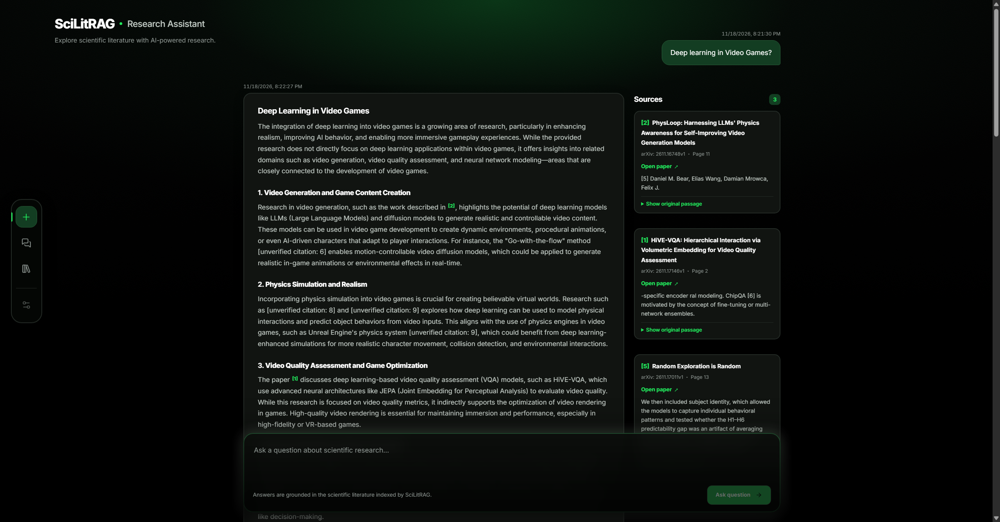
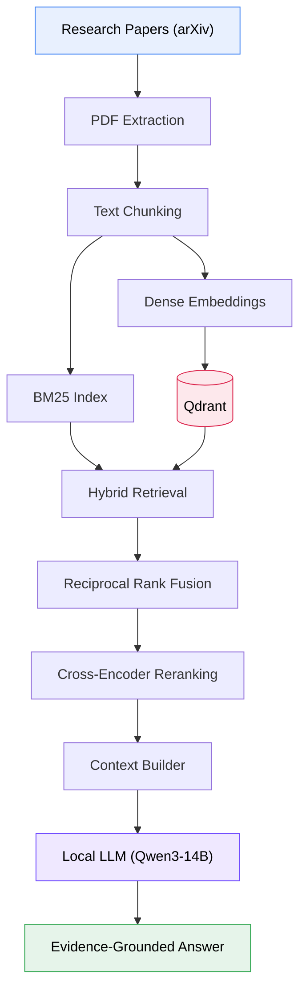

<div align="center">

# SciLitRAG

### A research-paper assistant powered by hybrid retrieval, cross-encoder reranking, and locally hosted language models

<p>
  
  
  
  
  
</p>

<p>
  
  
  
</p>

[Features](#key-features) •
[Architecture](#architecture) •
[Quick Start](#quick-start) •
[Usage](#usage) •
[Evaluation](#evaluation) •
[Roadmap](#roadmap)

<br>

<br>

</div>

## Overview

**SciLitRAG** is a retrieval-augmented generation (RAG) system that helps researchers search, explore, and synthesize information from scientific literature.

It retrieves relevant passages from research papers, reranks them by relevance, and generates answers **grounded in retrieved evidence, with source attribution**.

## Key Features

| Feature | Description |
|---|---|
| **Corpus ingestion** | Fetch and process research papers from arXiv |
| **Semantic search** | Retrieve relevant passages using dense vector embeddings |
| **Keyword search** | Capture exact terminology and technical keywords with BM25 |
| **Hybrid retrieval** | Combine keyword and semantic retrieval via Reciprocal Rank Fusion (RRF) |
| **Cross-encoder reranking** | Improve passage relevance before generation |
| **Evidence-grounded generation** | Generate research answers with a locally hosted language model |
| **Evaluation suite** | Benchmark retrieval, context selection, and answer quality |

## Architecture



## Technology Stack

| Component | Technology |
|---|---|
| **Language** | Python 3.12 |
| **Dependency management** | [uv](https://docs.astral.sh/uv/) |
| **PDF processing** | PyMuPDF |
| **Embeddings** | `BAAI/bge-m3` |
| **Keyword retrieval** | BM25 |
| **Vector database** | Qdrant |
| **Retrieval fusion** | Reciprocal Rank Fusion |
| **Reranker** | `BAAI/bge-reranker-v2-m3` |
| **Language model** | Qwen3-14B |
| **Deep learning** | PyTorch, Transformers |
| **GPU acceleration** | CUDA |

## Quick Start

### Prerequisites

- Python 3.12+
- [uv](https://docs.astral.sh/uv/)
- Docker and Docker Compose
- NVIDIA GPU with compatible CUDA support *(recommended for GPU inference)*

### 1. Clone the repository

```bash
git clone https://github.com/dasdebjeet/SciLitRAG.git
cd SciLitRAG
```

### 2. Install dependencies

```bash
uv sync
```

### 3. Start Qdrant

```bash
docker compose up -d
```

Default Qdrant endpoint: `http://localhost:16333`

### 4. Prepare the research corpus

Run the ingestion workflow in order:

```bash
uv run python scripts/ingestion/fetch_papers.py
uv run python scripts/ingestion/extract_text.py
uv run python scripts/ingestion/chunk_pages.py
uv run python scripts/ingestion/embed_chunks.py
uv run python scripts/utilities/setup_qdrant.py
uv run python scripts/ingestion/ingest_qdrant.py
```

> [!TIP]
> The scripts support additional configuration through command-line arguments. Use `--help` where available to inspect options.

> [!NOTE]
> The corpus, generated embeddings, Qdrant collection, and local language-model weights must be prepared or made available separately. `uv sync` installs Python dependencies; it does **not** download the complete research corpus or model weights.

## Usage

Ask a research question using the complete retrieval and generation pipeline:

```bash
uv run scilitrag-answer --query "How do reversible neural networks improve image reconstruction?"
```

<details>
<summary><b>Optional parameters</b></summary>

<br>

```bash
uv run scilitrag-answer \
    --query "Your research question" \
    --retrieval-k 20 \
    --top-k 5 \
    --max-context-tokens 6000 \
    --max-new-tokens 1200 \
    --device cuda
```

</details>

<details>
<summary><b>Individual retrieval components</b></summary>

<br>

```bash
uv run scilitrag-bm25 --help
uv run scilitrag-dense --help
uv run scilitrag-hybrid --help
uv run scilitrag-rerank --help
```

</details>

## Evaluation

SciLitRAG has been evaluated on a manually verified benchmark of **15 research questions** (13 answerable, 2 unanswerable).

### Retrieval

| Metric | Hybrid | Reranked |
|---|---:|---:|
| Paper Recall@5 | 1.000 | 1.000 |
| Paper Recall@10 | 1.000 | 1.000 |
| Paper MRR@10 | 1.000 | 1.000 |
| Paper nDCG@5 | 1.000 | 1.000 |
| Chunk Recall@10 | 0.7086 | **0.7560** |
| Chunk MRR@10 | 0.6564 | **0.7564** |
| Chunk nDCG@5 | 0.5510 | **0.5771** |

The reranker improves chunk-level ranking quality, although individual questions still exhibit retrieval weaknesses.

### Context Selection

An adaptive context-selection strategy was compared against a fixed top-10 context policy:

| Metric | Adaptive | Fixed top-10 |
|---|---:|---:|
| Avg. context tokens | **3,502** | 4,711 |
| Avg. selected passages | **7.54** | 10 |

Approximately **25.7% fewer context tokens**.

> [!NOTE]
> These results reflect the current benchmark and do not establish adaptive selection as universally optimal.

### Answer Quality

An initial manual review covered eight generated answers across four questions and two context-selection policies. Outputs were generally sound, but broader evaluation is needed before drawing strong conclusions.

## Project Structure

<details>
<summary><b>Show directory tree</b></summary>

```text
SciLitRAG/
├── data/
│   ├── raw/
│   ├── processed/
│   ├── metadata/
│   └── evaluation/
│
├── src/
│   └── scilitrag/
│       ├── core/
│       │   └── paths.py
│       ├── retrieval/
│       │   ├── bm25_retriever.py
│       │   ├── dense_retriever.py
│       │   ├── hybrid_retriever.py
│       │   └── reranker.py
│       ├── generation/
│       │   └── generator.py
│       └── pipeline/
│           ├── answer_pipeline.py
│           └── context_builder.py
│
├── scripts/
│   ├── ingestion/
│   │   ├── fetch_papers.py
│   │   ├── extract_text.py
│   │   ├── chunk_pages.py
│   │   ├── embed_chunks.py
│   │   └── ingest_qdrant.py
│   ├── evaluation/
│   │   ├── generate_benchmark.py
│   │   ├── evaluate_retrieval.py
│   │   ├── evaluate_context_selection.py
│   │   └── evaluate_answer_quality.py
│   ├── optimization/
│   │   └── reranker/
│   │       ├── benchmark_reranker.py
│   │       ├── export_reranker_onnx.py
│   │       ├── benchmark_reranker_onnx.py
│   │       ├── benchmark_reranker_onnx_execution.py
│   │       └── benchmark_reranker_onnx_threads.py
│   ├── utilities/
│   │   ├── validate_papers.py
│   │   ├── fix_paper_metadata.py
│   │   ├── setup_qdrant.py
│   │   ├── update_qdrant_metadata.py
│   │   └── verify_candidate_questions.py
│   └── diagnostics/
│       ├── test_context_builder.py
│       └── test_qdrant_search.py
│
├── tests/
├── compose.yaml
├── pyproject.toml
├── uv.lock
└── README.md
```

</details>

**Design principles**

| Directory | Purpose |
|---|---|
| `src/scilitrag/` | Reusable application logic |
| `scripts/` | Executable workflows, evaluation tools, utilities, and diagnostics |
| `data/` | Research corpus and evaluation artifacts |

## Current Limitations

- The benchmark is relatively small and requires broader evaluation.
- Retrieval quality varies across individual research questions.
- The system uses a local language model, so inference performance is hardware-dependent.
- The API and interactive user interface are planned extensions.

## Roadmap

- [ ] FastAPI backend for serving the RAG pipeline
- [ ] React-based research assistant interface
- [ ] Interactive source and evidence exploration
- [ ] Cross-paper comparison and synthesis
- [ ] Expanded retrieval and answer-quality benchmarks
- [ ] Improved observability and production deployment

## Project Status

The core **ingestion, hybrid retrieval, reranking, generation, and initial evaluation** workflows are implemented. The project is now transitioning toward a service-oriented backend and an interactive research interface.

---

<div align="center">

**SciLitRAG — Making scientific literature easier to search, understand, and connect.**

</div>