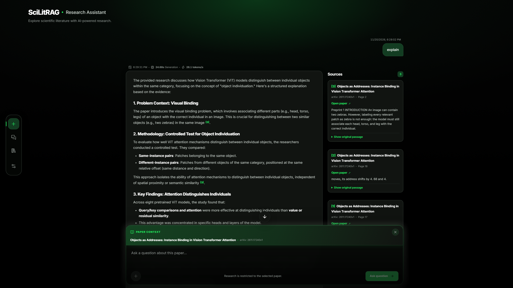
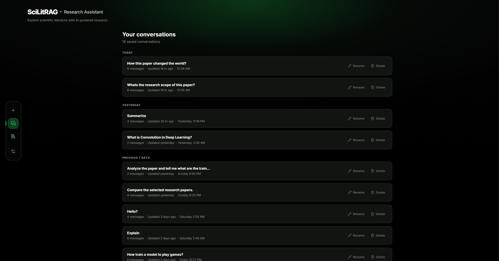
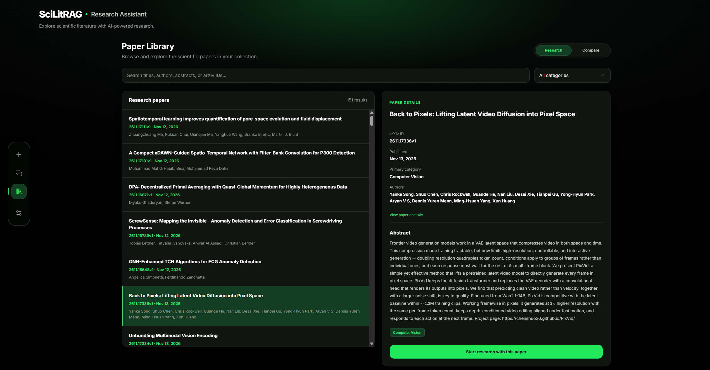
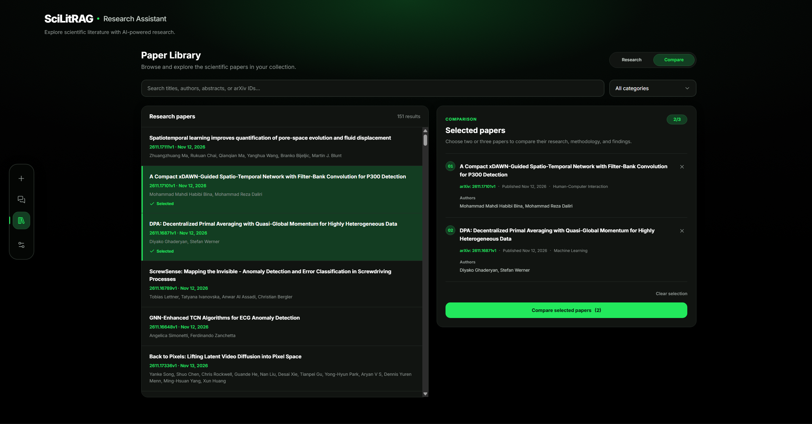
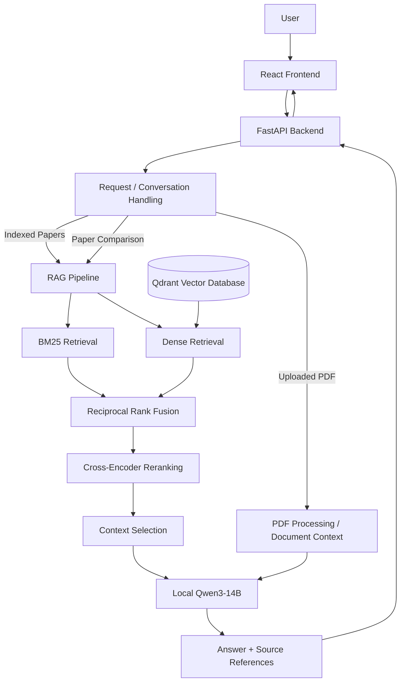
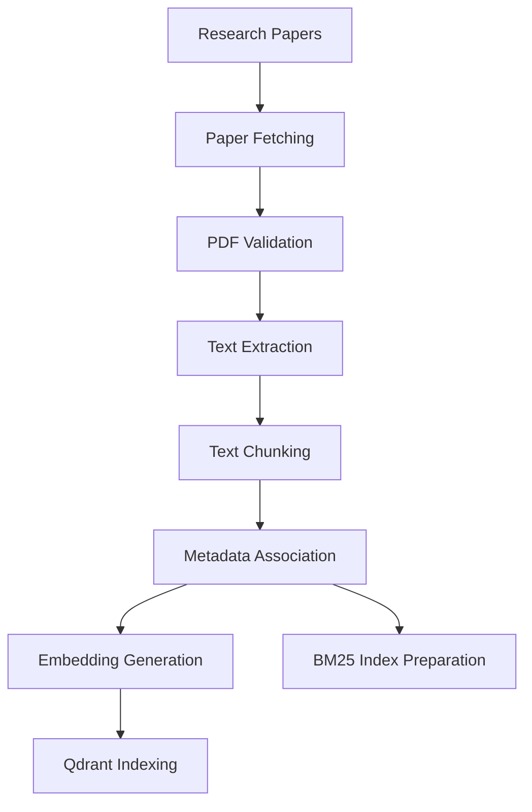
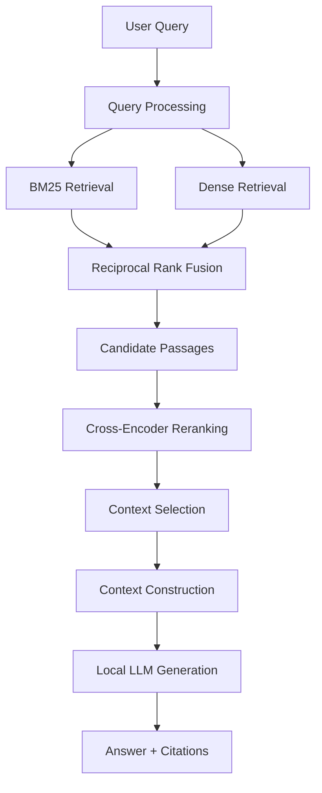

<div align="center">

# SciLitRAG

**Ask questions. Get answers grounded in research papers.**

Hybrid retrieval · Cross-encoder reranking · Locally hosted LLM

<p>
  
  
  
  
  
  
</p>

[Features](#key-features) · [Architecture](#system-architecture) · [Pipeline](#rag-pipeline) · [Installation](#installation) · [API](#api-reference) · [Evaluation](#evaluation) · [Documentation](#documentation)

<br>



<table border="0" cellspacing="0" cellpadding="8">
  <tr>
    <td width="33%" align="center">
      <br/>
      <sub><b>Conversations</b><br/>Cited, multi-turn answers</sub>
    </td>
    <td width="33%" align="center">
      <br/>
      <sub><b>Paper Library</b><br/>Browse and scope indexed papers</sub>
    </td>
    <td width="33%" align="center">
      <br/>
      <sub><b>Paper Comparison</b><br/>Ask across multiple papers</sub>
    </td>
  </tr>
</table>

</div>

<br>

**SciLitRAG** is a research-paper question-answering system built to make scientific literature easier to explore. It combines sparse and dense retrieval, Reciprocal Rank Fusion (RRF), cross-encoder reranking, and a locally hosted language model to generate answers grounded in retrieved evidence.

The project implements an end-to-end **Retrieval-Augmented Generation (RAG)** workflow, from paper ingestion and indexing to contextual retrieval and conversational question answering. Rather than relying on semantic similarity alone, SciLitRAG blends complementary retrieval strategies and reranks candidate passages before anything reaches the language model.

### At a Glance

| Aspect | Details |
| :--- | :--- |
| **Retrieval** | BM25 (sparse) + `BAAI/bge-m3` (dense) fused with Reciprocal Rank Fusion (RRF) |
| **Reranking** | `BAAI/bge-reranker-v2-m3` cross-encoder |
| **Generation** | Local `Qwen3-14B` — no third-party LLM API required |
| **Vector Store** | Qdrant |
| **Backend / Frontend** | FastAPI · React + TypeScript + Vite |
| **Interaction** | Multi-turn chat, paper comparison, PDF upload (up to **25 MB**) |
| **Verification** | Source citations with excerpts and arXiv links where available |

---

## Overview

Scientific papers hold valuable information, but finding relevant evidence across many documents is slow. Keyword search can miss semantically relevant passages, and standalone language models can produce unsupported or fabricated claims. SciLitRAG addresses both with a retrieval-first architecture:

1. Retrieve passages using both lexical and semantic search.
2. Fuse the rankings with Reciprocal Rank Fusion.
3. Rerank candidates with a cross-encoder.
4. Select the most relevant evidence to build the generation context.
5. Generate an evidence-grounded answer with a local language model.
6. Cite sources so every answer can be verified.

---

## Key Features

SciLitRAG pairs a hybrid retrieval pipeline with a conversational interface, so answers stay tied to the papers they come from.

### Retrieval and Ranking
- **Hybrid retrieval:** BM25 matches passages by lexical relevance and exact terminology, while dense retrieval finds conceptually related passages through semantic embeddings. Reciprocal Rank Fusion (RRF) merges both rankings into a stronger candidate set.
- **Cross-encoder reranking:** A second-stage cross-encoder scores query–passage relevance jointly, rather than relying only on independent embedding similarity, to refine the initial results.
- **Evidence-grounded generation:** Retrieved passages are assembled into the model's context, which is designed to prioritize that evidence and return source references for inspection.

### Conversation and Documents
- **Multi-turn conversations:** Ask follow-up questions in an ongoing session. Conversation history is passed into the question-answering workflow to preserve context.
- **Paper comparison:** Select multiple indexed papers and ask questions that require comparing their content.
- **PDF uploads:** Upload a research PDF and use it as the document scope for a conversation, with no need for it to be in the pre-indexed collection. Uploads are limited to **25 MB** per PDF.
- **Persistent chat history:** Conversations are saved in the frontend so you can revisit them at any time.

### Transparency and Deployment
- **Source citations:** Responses can include the retrieved passages, supporting excerpts, and links to the corresponding arXiv papers where available.
- **Local inference:** Generation runs on a locally hosted `Qwen3-14B` model, so you do not depend on a third-party LLM API.

---

## System Architecture

SciLitRAG consists of a React frontend, a FastAPI backend, a retrieval and generation pipeline, and supporting infrastructure.



### Main Components

| Component | Responsibility |
| :--- | :--- |
| **React Frontend** | UI, conversations, paper selection, uploads, answer rendering |
| **FastAPI** | HTTP API and application orchestration |
| **BM25 Retriever** | Lexical retrieval |
| **Dense Retriever** | Semantic retrieval using embeddings |
| **Qdrant** | Vector storage and similarity search |
| **Reciprocal Rank Fusion** | Combines sparse and dense rankings |
| **Cross-Encoder** | Refines candidate passage rankings |
| **Context Builder** | Selects and assembles evidence for generation |
| **Qwen3-14B** | Locally hosted response generation |

---

## RAG Pipeline

The workflow has two major stages: offline ingestion and online retrieval + generation.

### 1. Offline Ingestion

Papers are collected, processed, embedded, and indexed before the retrieval system uses them.



- Fetch research papers from arXiv.
- Validate downloaded PDFs.
- Extract text and document metadata.
- Split content into smaller passages.
- Generate dense embeddings with `BAAI/bge-m3`.
- Index vectors and metadata in Qdrant.
- Prepare the lexical data used by BM25.

### 2. Online Retrieval & Generation

When a user submits a question, the application retrieves evidence and generates an answer.



### Retrieval Strategy

| Stage | Technique | Purpose |
| :--- | :--- | :--- |
| **Sparse retrieval** | BM25 | Lexical matching, useful for specific terminology, technical expressions, and named concepts |
| **Dense retrieval** | `BAAI/bge-m3` | Semantic matching that finds relevant content even when wording differs from the query |
| **Rank fusion** | Reciprocal Rank Fusion | Combines the sparse and dense rankings |
| **Reranking** | `BAAI/bge-reranker-v2-m3` | Scores query–passage pairs to refine the candidate ranking |
| **Context selection** | Adaptive selection | Chooses relevant passages within the available context budget |
| **Generation** | `Qwen3-14B` | Formulates a response from the selected evidence |

---

## Technology Stack

| Category | Technology |
| :--- | :--- |
| **Language** | Python 3.12 |
| **Environment & dependencies** | `uv` |
| **Backend** | FastAPI, Uvicorn |
| **Frontend** | React, TypeScript, Vite |
| **Document processing** | PyMuPDF |
| **Sparse retrieval** | BM25 |
| **Embedding model** | `BAAI/bge-m3` |
| **Vector database** | Qdrant |
| **Rank fusion** | Reciprocal Rank Fusion |
| **Reranking model** | `BAAI/bge-reranker-v2-m3` |
| **Language model** | `Qwen3-14B` |
| **Deep learning** | PyTorch, Transformers |
| **GPU acceleration** | CUDA |
| **Infrastructure** | Docker Desktop |

---

## Project Structure

```text
SciLitRAG/
│
├── data/
│   ├── raw/                    # Downloaded research papers
│   ├── processed/              # Extracted and processed documents
│   ├── metadata/               # Paper and processing metadata
│   └── evaluation/             # Evaluation datasets and results
│
├── docs/
│   ├── images/                 # README screenshots
│   ├── ARCHITECTURE.md
│   ├── RAG_PIPELINE.md
│   ├── API_REFERENCE.md
│   ├── SETUP.md
│   ├── DEVELOPMENT.md
│   └── EVALUATION.md
│
├── src/
│   └── scilitrag/
│       ├── api/                # FastAPI application and endpoints
│       ├── core/               # Shared configuration and utilities
│       ├── retrieval/
│       │   ├── bm25_retriever.py
│       │   ├── dense_retriever.py
│       │   ├── hybrid_retriever.py
│       │   └── reranker.py
│       ├── generation/
│       │   └── generator.py
│       └── pipeline/
│           ├── answer_pipeline.py
│           └── context_builder.py
│
├── frontend/                   # React application
│
├── scripts/
│   ├── ingestion/              # Paper ingestion and indexing
│   ├── evaluation/             # Retrieval and answer evaluation
│   ├── optimization/           # Reranker optimization experiments
│   ├── utilities/              # Validation and maintenance tools
│   └── diagnostics/            # Pipeline and component diagnostics
│
├── tests/                      # Automated tests
│
├── compose.yaml                # Docker service configuration
├── pyproject.toml              # Python project configuration
├── uv.lock                     # Locked Python dependencies
└── README.md
```

---

## Installation

### Prerequisites

- Windows 11 with WSL2 and Ubuntu.
- Python 3.12.
- `uv` package manager.
- Node.js and npm.
- Docker Desktop.
- A CUDA-compatible NVIDIA GPU with appropriate drivers (for GPU-accelerated inference).
- A local inference runtime with the configured `Qwen3-14B` model available.

### 1. Clone the repository

```bash
git clone [https://github.com/dasdebjeet/SciLitRAG.git](https://github.com/dasdebjeet/SciLitRAG.git)
cd SciLitRAG
```

### 2. Install Python dependencies

From the project root:

```bash
uv sync
```

### 3. Install frontend dependencies

```bash
cd frontend
npm install
```

### 4. Configure the application

Configure the application using the settings expected by the project. Ensure that the backend can reach:

- Qdrant at the configured endpoint.
- The local language model runtime.
- Required model and data directories.
- Any application-specific configuration.

Refer to the [Setup Guide](docs/SETUP.md) for configuration guidance and additional setup details. Do not commit credentials, secrets, or machine-specific configuration.

---

## Running the Application

SciLitRAG runs as separate frontend and backend development servers, with Qdrant managed through Docker Desktop.

### 1. Start Docker Desktop

Launch Docker Desktop and wait until the Docker Engine is running. Qdrant should then be available at:

`http://localhost:16333`

If the database is unavailable, verify that the container is running:

```bash
docker ps
```

If it isn't, inspect `compose.yaml` and start the configured service from the project root.

### 2. Start the backend

In a WSL terminal:

```bash
cd /mnt/d/SciLitRAG
uv run uvicorn src.scilitrag.api.main:app --host 127.0.0.1 --port 8000
```

### 3. Start the frontend

In a second WSL terminal:

```bash
cd /mnt/d/SciLitRAG/frontend
npm run dev -- --host 0.0.0.0
```

### Development Services

| Service | Address |
| :--- | :--- |
| **React / Vite Frontend** | `http://localhost:5173` |
| **FastAPI Backend** | `http://127.0.0.1:8000` |
| **Swagger Documentation** | `http://127.0.0.1:8000/docs` |
| **Qdrant** | `http://localhost:16333` |

> **Note:** The local language model runtime must also be running and reachable using the configuration expected by the backend.
>
> **Development note:** The Vite command binds to `0.0.0.0`, allowing access through network interfaces. Use it only in a trusted development environment.

For detailed setup instructions and troubleshooting, see [Setup Guide](docs/SETUP.md).

---

## Using SciLitRAG

<details open>
<summary><b>Ask questions about research papers</b></summary>
<br>

1. Open the frontend in your browser.
2. Start a new conversation.
3. Select the relevant indexed paper scope, if required.
4. Enter a research question.
5. Review the generated response and its citations.
6. Ask follow-up questions to continue the conversation.

</details>

<details>
<summary><b>Compare research papers</b></summary>
<br>

1. Open the paper selection interface.
2. Select the papers you want to compare.
3. Submit a comparative question.
4. Review the response and its supporting sources.

Useful for questions about similarities, differences, methodologies, findings, and other paper-specific details.

</details>

<details>
<summary><b>Upload a research paper</b></summary>
<br>

1. Start or open a conversation.
2. Upload a PDF (up to **25 MB**).
3. Ask questions about the uploaded paper.
4. Review the response and available supporting references.

</details>

<details>
<summary><b>Review previous conversations</b></summary>
<br>

Saved conversations are available through the conversation interface. The application also provides a paper library and theme preferences.

</details>

---

## API Reference

SciLitRAG exposes its functionality through a REST API built with FastAPI. The endpoints are organized into three groups: **Health**, **Research**, and **Uploads**.

### Health

| Method | Endpoint | Description |
| :--- | :--- | :--- |
| `GET` | `/health` | Check API liveness |
| `GET` | `/health/ready` | Check API readiness |

### Research

| Method | Endpoint | Description |
| :--- | :--- | :--- |
| `POST` | `/api/v1/ask` | Answer a research question |
| `GET` | `/api/v1/papers` | List available research papers |
| `POST` | `/api/v1/compare` | Compare research papers |

### Uploads

| Method | Endpoint | Description |
| :--- | :--- | :--- |
| `POST` | `/api/v1/uploads` | Upload a research paper |

### Interactive API Documentation

FastAPI automatically generates interactive API documentation using OpenAPI and Swagger UI. After starting the backend, access:

- **Swagger UI:** `http://127.0.0.1:8000/docs`
- **OpenAPI schema:** `http://127.0.0.1:8000/openapi.json`

Swagger UI provides the request schemas, parameters, response models, and an interface for testing the available endpoints directly. For additional endpoint documentation, see [API Reference](docs/API_REFERENCE.md).

---

## Evaluation

SciLitRAG was evaluated on a manually verified benchmark of **15 research questions** (13 answerable, 2 unanswerable), examining retrieval quality, reranking, context selection, and answer quality.

### 1. Retrieval Performance

Hybrid retrieval compared with the reranked results:

| Metric | Hybrid Retrieval | After Reranking |
| :--- | :---: | :---: |
| **Paper Recall@5** | 1.000 | 1.000 |
| **Paper Recall@10** | 1.000 | 1.000 |
| **Paper MRR@10** | 1.000 | 1.000 |
| **Paper nDCG@5** | 1.000 | 1.000 |
| **Chunk Recall@10** | 0.7086 | **0.7560** |
| **Chunk MRR@10** | 0.6564 | **0.7564** |
| **Chunk nDCG@5** | 0.5510 | **0.5771** |

The relevant paper was consistently retrieved within the evaluated cutoffs. At the chunk level, reranking improved the measured metrics, particularly MRR@10, highlighting the difference between finding the right paper and finding the most relevant passages within it.

### 2. Context Selection

Adaptive context selection compared with a fixed top-10 policy:

| Metric | Adaptive Selection | Fixed Top-10 |
| :--- | :---: | :---: |
| **Average context tokens** | **3,502** | 4,711 |
| **Average selected passages** | **7.54** | 10 |

Adaptive selection used approximately **25.7% fewer context tokens** in this evaluation, suggesting that choosing a smaller set of relevant passages can reduce context size without relying on a fixed passage count.

> **Note:** These results are specific to the evaluated benchmark and do not establish that adaptive selection is universally optimal.

### 3. Answer Quality

A manual review covered **eight generated answers** (4 research questions × 2 context selection policies). The reviewed answers were generally sound in the evaluated examples.

> **Important:** The answer-quality evaluation is limited in size. A larger benchmark and more systematic evaluation are needed before making broader claims about answer correctness, factual consistency, or hallucination resistance.

### Evaluation Scope

The current evaluation is an initial assessment of the pipeline. Results should be read in the context of the benchmark size and methodology, and are not a substitute for large-scale or domain-expert validation. For the full methodology, metric definitions, interpretation, and limitations, see [Evaluation](docs/EVALUATION.md).

---

## Limitations

| Area | Detail |
| :--- | :--- |
| **Evaluation scale** | The benchmark contains only 15 research questions |
| **Answer-quality validation** | Manual review covers a relatively small number of generated responses |
| **Document extraction** | PDF extraction quality varies with structure, formatting, tables, and figures |
| **Retrieval coverage** | Depends on the indexed collection and the quality of its extracted text and metadata |
| **Local inference** | Running a 14B-parameter model locally requires suitable hardware and memory |
| **Domain generalization** | Performance across all scientific disciplines has not been established |
| **Citation verification** | Retrieved references should still be checked against the original papers |

---

## Future Improvements

- Expand the benchmark with a larger, more diverse set of research questions.
- Introduce more systematic answer-quality and faithfulness evaluation.
- Improve retrieval and context selection through further experiments.
- Evaluate extraction strategies for tables, figures, and complex layouts.
- Explore further inference and reranking optimizations.
- Broaden support for scientific document formats and metadata.
- Improve observability, logging, and performance monitoring.

---

## Documentation

Explore the detailed documentation for the architecture, retrieval pipeline, setup, development, API, and evaluation:

| Document | Description |
| :--- | :--- |
| [System Architecture](docs/ARCHITECTURE.md) | Application components, system design, and interactions |
| [RAG Pipeline](docs/RAG_PIPELINE.md) | Paper ingestion, hybrid retrieval, reranking, and generation |
| [API Reference](docs/API_REFERENCE.md) | Backend endpoints and API usage |
| [Setup Guide](docs/SETUP.md) | Installation, configuration, startup, and troubleshooting |
| [Development Guide](docs/DEVELOPMENT.md) | Repository structure, testing, debugging, and development |
| [Evaluation](docs/EVALUATION.md) | Benchmark methodology, retrieval metrics, and results |

---

## Acknowledgements

SciLitRAG builds upon several open-source technologies and pretrained models, including Qdrant, PyTorch, FastAPI, BAAI embedding and reranking models, and Qwen. Their contributions make it possible to build an end-to-end research assistant from locally hosted machine learning components.

---

<div align="center">

**SciLitRAG** — Making scientific literature easier to search, explore, and understand.

</div>