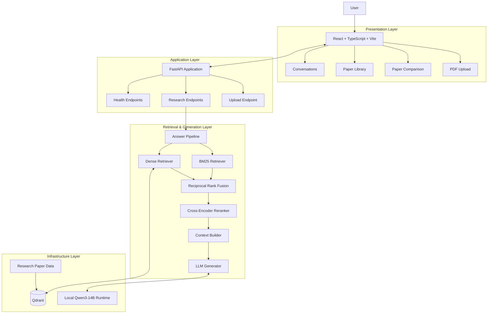
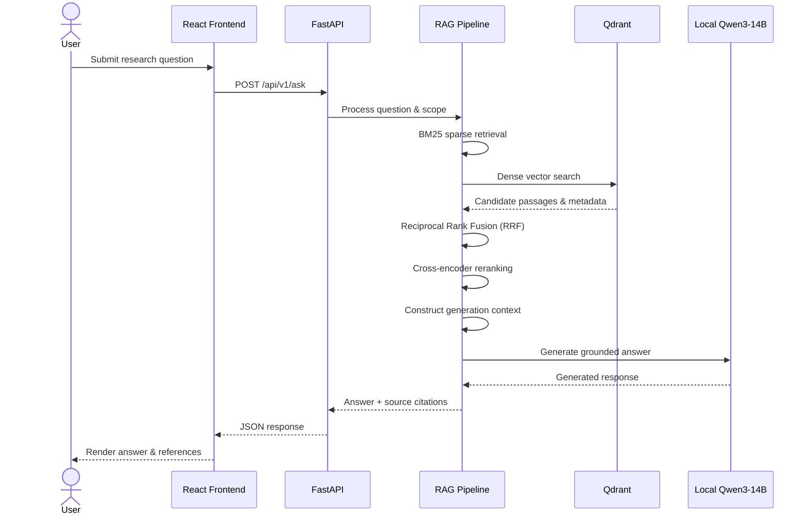
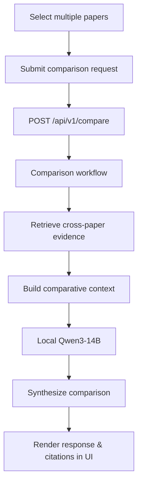
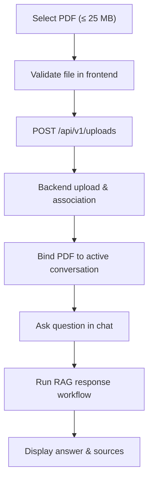

# SciLitRAG — System Architecture

**SciLitRAG** is a research-paper question-answering application built around a **Retrieval-Augmented Generation (RAG)** pipeline. It pairs a React frontend and FastAPI backend with hybrid retrieval, cross-encoder reranking, and a locally hosted language model to deliver grounded, citation-backed answers from scientific literature.

### Supported Workflows

- **Single & Multi-Paper Q&A:** Ask targeted or comparative questions across indexed research papers.
- **Document Upload & Q&A:** Upload research PDFs (up to **25 MB**) and query their contents within a conversation.

---

## 1. High-Level Architecture

The system is organized into four logical layers with clear separation of concerns:

| Layer | Core Responsibilities | Key Components |
| :--- | :--- | :--- |
| **Presentation** | Renders UI, manages conversation state and document scope, displays answers and citations | React, TypeScript, Vite |
| **Application** | Exposes REST APIs, validates requests/uploads, orchestrates research workflows | Python 3.12, FastAPI, Uvicorn |
| **Retrieval & Generation** | Retrieves candidate passages, fuses/reranks results, builds context, generates answers | BM25, `BAAI/bge-m3`, RRF, `BAAI/bge-reranker-v2-m3`, `Qwen3-14B` |
| **Infrastructure** | Persists vector embeddings and metadata, hosts local LLM runtime and paper corpus | Qdrant, Local LLM Runtime, Paper Data |

### System Overview Diagram

> *Note: This diagram illustrates logical component boundaries and primary data flows rather than low-level deployment or network topology.*

---

## 2. Presentation Layer

Built with **React**, **TypeScript**, and **Vite**, the frontend handles user interactions, client-side state, and rendering of responses alongside source citations.

### Interface Modules

| Component | Responsibility |
| :--- | :--- |
| **Conversations** | Create, switch between, and manage research threads |
| **Chat Interface** | Submit prompts and render streaming or completed responses |
| **Paper Library** | Browse available indexed research papers |
| **Paper Selection** | Scope queries to a single indexed paper |
| **Paper Comparison** | Select multiple indexed papers for side-by-side/cross-paper analysis |
| **PDF Upload** | Upload research PDFs (up to **25 MB**) and bind them to a conversation |
| **Source References** | Surface cited passages, source links, and supporting excerpts |
| **Theme Preferences** | Switch and persist UI appearance settings |

### State, History & Scope Rules

- **Persistence & History Window:** Conversation threads are stored in browser `localStorage`. For multi-turn context, the client sends up to the **12 most recent messages**, truncating each message to **2,000 characters**.
- **Scope Precedence:** A query can target a single indexed paper, multiple indexed papers, or a conversation-scoped uploaded PDF. When an **uploaded PDF** is present for the active conversation, it takes precedence over indexed-paper selection.

---

## 3. Application Layer

Implemented in **Python 3.12** with **FastAPI** and served via **Uvicorn**, the backend exposes REST endpoints and coordinates retrieval and generation workflows.

### API Surface

The backend exposes health checks, paper discovery, question answering, paper comparison, and PDF upload routes. See [API_REFERENCE.md](API_REFERENCE.md) for the endpoint list and live schema discovery.

### Request Lifecycle

1. **Dispatch:** The frontend sends an HTTP request with the prompt, conversation history, and active document scope.
2. **Scope Resolution:** FastAPI resolves whether the request targets uploaded-document context or indexed papers.
3. **Workflow Routing:** The corresponding endpoint invokes the Q&A, comparison, or upload workflow.
4. **RAG Execution:** The pipeline retrieves, fuses, reranks, and synthesizes an evidence-backed response.
5. **Response & Render:** FastAPI returns the answer and source metadata, which the frontend renders with citations.

---

## 4. Retrieval & Generation Layer

The RAG pipeline combines lexical matching, dense semantic search, rank fusion, cross-encoder reranking, budget-aware context assembly, and local generation.

1. **Sparse Retrieval (BM25):** Matches exact lexical terms, acronyms, symbols, and domain-specific phrasing across indexed passages.
2. **Dense Retrieval (`BAAI/bge-m3`):** Embeds queries and passages into dense vectors and queries **Qdrant** for semantic similarity.
3. **Hybrid Fusion (Reciprocal Rank Fusion):** Merges BM25 and dense result lists using rank positions (`RRF`) rather than raw score magnitudes, balancing exact keyword precision with semantic recall.
4. **Cross-Encoder Reranking (`BAAI/bge-reranker-v2-m3`):** Jointly scores `(query, passage)` pairs to re-order top candidates with higher cross-attention accuracy than bi-encoder similarity alone.
5. **Context Construction:** Selects passages within the token/context budget, comparing **adaptive context selection** against **fixed top-k** passage selection.
6. **Answer Generation (`Qwen3-14B`):** Synthesizes a grounded response from the assembled evidence and conversation history, including references to supporting passages and source papers where available.

---

## 5. Infrastructure Layer

- **Vector Database (Qdrant):** Stores passage embeddings and payload metadata, serving dense similarity queries. In local development, Qdrant runs via Docker Desktop and is exposed at `http://localhost:16333`.
- **Local LLM Runtime (`Qwen3-14B`):** Runs inference locally rather than calling external third-party LLM APIs. Runtime and hardware/server tuning details are maintained outside this document.
- **Research Corpus & Ingestion:** Source papers and metadata feed the indexing pipeline documented in [RAG_PIPELINE.md](RAG_PIPELINE.md).

---

## 6. Core Workflows

### 6.1 Research Question Answering

### 6.2 Research Paper Comparison

### 6.3 PDF Upload & Querying

> *Internal ingestion, chunking, and lifecycle details for uploaded PDFs are maintained alongside the backend implementation and in [RAG_PIPELINE.md](RAG_PIPELINE.md).*

---

## 7. Local Development Topology

During local development, services run independently across local ports:

| Service | Stack / Runtime | Local Endpoint | Notes |
| :--- | :--- | :--- | :--- |
| **Frontend** | React, TypeScript, Vite | `http://localhost:5173` | Dev server |
| **Backend API** | Python 3.12, FastAPI, Uvicorn | `http://127.0.0.1:8000` | REST API |
| **Vector Store** | Qdrant (Docker Desktop) | `http://localhost:16333` | Dense vector index |
| **Local LLM** | `Qwen3-14B` runtime | *Configured locally* | See local runtime config |