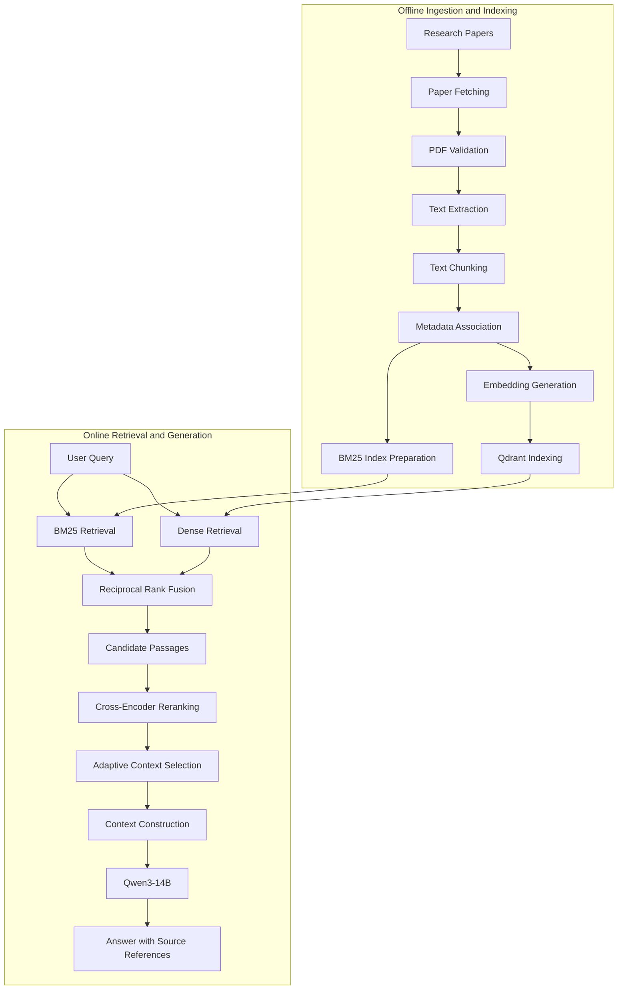

# SciLitRAG — RAG Pipeline

**SciLitRAG** implements an end-to-end **Retrieval-Augmented Generation (RAG)** pipeline tailored for scientific literature question answering. Rather than querying a language model directly, the pipeline retrieves relevant passages from research papers, refines their ranking, and constructs an evidence-grounded context for generation.

### Core Pipeline Components

- **Ingestion & Extraction:** Automated PDF collection, validation, and text extraction (`PyMuPDF`)
- **Chunking & Metadata:** Passage segmentation with persistent document and source attribution
- **Hybrid Retrieval:** Dense semantic search (`BAAI/bge-m3` via Qdrant) paired with sparse lexical retrieval (`BM25`)
- **Rank Fusion & Reranking:** Reciprocal Rank Fusion (`RRF`) followed by cross-encoder scoring (`BAAI/bge-reranker-v2-m3`)
- **Context & Generation:** Adaptive context selection feeding a locally hosted `Qwen3-14B` model

The architecture is organized into two primary execution phases:
1. **Offline Ingestion & Indexing:** Collecting, validating, chunking, and indexing research documents.
2. **Online Retrieval & Generation:** Retrieving, reranking, and synthesizing grounded answers for incoming queries.

---

## 1. Pipeline Overview

---

## Part I — Offline Ingestion and Indexing

### 1.1 Research Paper Collection
- **Process:** Collects scientific papers from **arXiv** and stores raw PDFs alongside paper records in the project's raw data directory.
- **Input:** Research paper records and downloadable PDFs.
- **Output:** Local research PDFs and associated paper metadata.

### 1.2 PDF Validation
- **Process:** Validates downloaded files prior to parsing to catch corrupted or incomplete PDFs that would degrade downstream extraction and retrieval quality.
- **Input:** Downloaded PDF files.
- **Output:** Validated PDF documents and validation status metadata.

### 1.3 Text Extraction
- **Process:** Extracts textual content from validated PDFs using **PyMuPDF**. Extraction fidelity naturally varies with complex multi-column layouts, embedded figures, and tables.
- **Input:** Validated research PDFs.
- **Output:** Extracted document text and structural document metadata.

### 1.4 Text Chunking
- **Process:** Splits full-text papers into smaller, retrievable passages (chunks) so the system can pinpoint relevant sections rather than indexing entire papers as monolithic units.
- **Input:** Extracted research paper text.
- **Output:** Segmented text chunks retaining originating document associations.

### 1.5 Metadata Association
- **Process:** Attaches source attribution metadata to each chunk throughout the indexing workflow to enable accurate citation display in the UI.
- **Tracked Attributes (Implementation-Defined Schema):**
  - Paper title & arXiv identifier (where available)
  - Document identity & source-document references
  - Passage-level positioning/identification metadata

### 1.6 Dense Embedding Generation
- **Process:** Encodes text passages into dense numerical vectors using **`BAAI/bge-m3`**, enabling conceptual similarity matching even when query phrasing diverges from paper terminology.
- **Input:** Processed research passages.
- **Output:** Dense vector embeddings (`BAAI/bge-m3`).

### 1.7 Qdrant Indexing
- **Process:** Stores dense passage embeddings alongside their payload metadata in **Qdrant** to serve low-latency semantic similarity searches.
- **Input:** Passage embeddings and payload metadata.
- **Output:** Searchable Qdrant vector collection.

### 1.8 BM25 Index Preparation
- **Process:** Builds lexical retrieval structures over the processed passages for **BM25**, providing exact-term matching complementary to semantic vectors.
- **Input:** Processed research passages and text content.
- **Output:** Indexed lexical statistics for BM25 retrieval.

---

## Part II — Online Retrieval and Generation

### 2.1 Query Processing & Hybrid Retrieval
When a user submits a question, the backend dispatches the query across two parallel retrieval paths:
- **Sparse Retrieval (`BM25`):** Scores passages via lexical overlap—effective for specialized terminology, acronyms, symbols, and named methods.
- **Dense Retrieval (`BAAI/bge-m3`):** Embeds the query and queries **Qdrant** for semantic similarity—effective for paraphrased or conceptual queries.

### 2.2 Reciprocal Rank Fusion (RRF)
Because sparse BM25 scores and dense cosine similarities operate on incompatible scales, SciLitRAG merges both ranked candidate lists using **Reciprocal Rank Fusion (RRF)**:

$$RRF(d) = \sum_{r \in R} \frac{1}{k + \text{rank}_r(d)}$$

Where:
- $d$ is a candidate document or passage.
- $R$ is the set of ranked retrieval lists (BM25 and Dense).
- $\text{rank}_r(d)$ is the 1-based rank position of passage $d$ in list $r$.
- $k$ is a smoothing constant controlling the relative weight of lower-ranked positions.

Passages ranked near the top across both lexical and semantic lists receive higher fused scores.

### 2.3 Cross-Encoder Reranking
- **Model:** `BAAI/bge-reranker-v2-m3`
- **Mechanism:** Unlike bi-encoder dense retrieval (which encodes query and passage independently), the cross-encoder evaluates each `(query, passage)` pair jointly to compute fine-grained relevance scores and refine passage ordering prior to context assembly.

### 2.4 Adaptive Context Selection & Construction
1. **Adaptive Context Selection:** Evaluates an adaptive selection policy rather than always passing a fixed number of passages, filtering out redundant or low-value chunks to conserve context budget.
2. **Context Construction:** Formats the selected passages and their source metadata into a structured prompt context for the generator.

### 2.5 Answer Generation & Citation Attribution
- **Generator:** Locally hosted **`Qwen3-14B`** (eliminating reliance on external third-party LLM APIs).
- **Inputs:** User question, selected research evidence, and recent conversational context (when applicable).
- **Outputs:** A grounded answer prioritizing retrieved evidence, paired with source paper details, supporting excerpts, passage metadata, and arXiv links where available.

---

## Part III — Design Rationale

### Why Hybrid Retrieval?

| Dimension | BM25 (Sparse) | Dense Retrieval (`BAAI/bge-m3`) |
| :--- | :--- | :--- |
| **Matching Basis** | Exact lexical term overlap | Vector space semantic similarity |
| **Exact Terminology** | Strong for rare terms, formulas, and acronyms | May vary depending on embedding representations |
| **Paraphrased Queries** | Limited by vocabulary mismatch | Captures conceptually related passages |
| **Representation** | Sparse lexical term statistics | Dense numerical vectors |
| **Primary Role** | Keyword-anchored candidate recall | Concept-anchored candidate recall |

### Why Two-Stage Reranking & Adaptive Context?
- **Two-Stage Reranking:** Initial sparse/dense retrieval optimizes for fast recall over the full corpus, whereas cross-encoder reranking optimizes for precision at the top of the context window.
- **Adaptive Context Selection:** Different questions require varying amounts of supporting evidence. Dynamically sizing the context avoids diluting the prompt with tangential passages while preserving necessary evidence (benchmarked against fixed `top-10` selection in [EVALUATION.md](EVALUATION.md)).

---

## Related workflows

Conversation state, paper comparison, and uploaded-PDF behavior are described in [ARCHITECTURE.md](ARCHITECTURE.md). API routes and payload discovery are covered in [API_REFERENCE.md](API_REFERENCE.md).

## Evaluation

Pipeline benchmark results, methodology, and limitations are maintained in [EVALUATION.md](EVALUATION.md) so the measurements have one source of truth.
